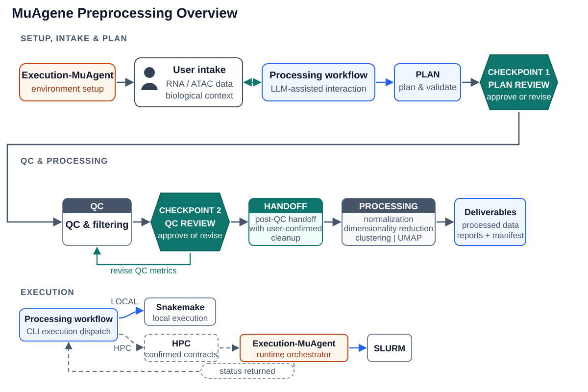

# MuAgene

MuAgene is a reproducible single-cell RNA and ATAC preprocessing workflow with
LLM assistance at selected interaction and review steps. A predefined, branch-aware
Snakemake pipeline performs the scientific computations; the LLM helps collect context,
present the generated plan and QC evidence, and translate user decisions into supported
CLI commands. MuAgene is not an autonomous agent that designs or changes the analysis
as it runs.

MuAgene supports RNA-only, ATAC-only, paired multiome, and unpaired RNA-plus-ATAC
workflows. It produces quality-controlled, per-modality representations through
clustering and UMAP. Multimodal integration, cell-type annotation, marker discovery,
and gene-regulatory network inference are outside its scope.



## How the workflow works

```text
Intake: confirm inputs, workflow branch, biological context, and execution mode
  → Context parsing, input validation, plan assembly, and QC threshold preview
  → CHECKPOINT 1: user reviews and approves or revises the plan
  → Ambient-RNA correction, modality-specific QC, and doublet removal
  → CHECKPOINT 2: user reviews and approves or revises observed QC
  → Post-QC data and manifest handoff
  → User confirms whether to start the finish batch
  → Per-modality normalization/feature selection, dimensionality reduction,
    neighbor graphs, clustering, and UMAP
  → Processed data, reports, review notebook, and manifests
```


The stage graph and scientific implementations are defined in code. Proposed QC
cutoffs and retention previews are computed from the data and configured policies.
LLM assistance is used around intake, plan presentation, QC review and parameter
revision, and explanation of execution findings. It runs in an external host with
repository and shell access, following the supplied instructions. Scientific
decisions and approvals remain with the user. The CLI records parameters and
approvals, and Snakemake executes the approved workflow.

There are two formal pipeline gates: `plan_review` and `post_qc_review`. The additional
confirmation before the finish batch is part of the LLM-assisted interaction procedure,
not a third Snakemake gate. The finish batch runs unattended with the planned parameters.

Detailed stages, supported formats, QC defaults, and outputs are documented in the
[Processing-MuAgent guide](Processing-MuAgent/README.md).

## Processing and Execution components

The existing component and CLI names retain the `MuAgent` suffix; they are the
scientific-workflow and platform-execution layers, not two independent LLM agents.

| Component | Responsibility | Interface |
|---|---|---|
| [Processing-MuAgent](Processing-MuAgent/README.md) | Input validation, plan assembly, scientific stages, parameter provenance, review checkpoints, and deliverables | `Processing-MuAgent` / `executor` CLI, with instructions for LLM-assisted interaction |
| [Execution-MuAgent](Execution-MuAgent/README.md) | Machine setup, environment provisioning, SLURM submission, supervision, and structured execution findings | Platform CLI invoked through structured job specifications; direct operator use for setup and maintenance |

For local runs, the Processing CLI invokes Snakemake directly. For SLURM runs, it
writes a job specification and invokes `Execution-MuAgent execute-spec` to provision,
submit, and monitor a head job that runs Snakemake and dispatches stage jobs. This
handoff uses CLI subprocesses and structured files, not a second LLM conversation.
Execution-MuAgent does not change the scientific plan or choose recovery actions;
findings return through Processing for user review.

## Getting started

### 1. Set up MuAgene

From the MuAgene repository, bootstrap the integrated `muagene` environment:

```bash
bash Execution-MuAgent/scripts/bootstrap.sh \
  --processing-repo Processing-MuAgent
conda activate muagene
```

CPU setup is the default; current preprocessing stages are CPU-only. See the
[Execution-MuAgent installation guide](Execution-MuAgent/README.md#installation) for
details.

### 2. Start an LLM-assisted preprocessing run

Use an LLM host with repository access and permission to run shell commands. Ask it to
read the root [`AGENT.md`](AGENT.md), which routes it to the instructions for the
current workflow state. Installing the packages alone does not start a chat interface
or an LLM service.

Example request:

```text
Help me run the MuAgene preprocessing workflow. Read the root AGENT.md and follow
its loading order, using only the Processing skill selected by observable run state.

Task: Preprocess <RNA-only | ATAC-only | paired | unpaired> single-cell data.
Run directory: <path>
Inputs: <input path(s)>

Biological context:
- genome assembly: <assembly>
- organism: <organism>
- tissue or cell line: <context>
- assay: <assay>
- marker genes for the ambient-RNA check: <genes | defer | skip>

Execution mode: <local | SLURM>
Environment: muagene

Stop at each review checkpoint and wait for my explicit approval. After the
post-QC handoff, ask before proceeding to the finish batch.
```

The LLM-assisted intake collects missing information and confirms the workflow and
execution settings before launching planning compute. Input validation, plan assembly,
and QC exploration run before plan approval; QC filtering runs only after approval.

### 3. Review, monitor, and collect outputs

Review the generated plan and QC reports, approve or revise the proposed settings,
and confirm whether to proceed after the post-QC handoff. Status, revision, and
approval actions use the Processing CLI; the LLM can help explain findings and invoke
the relevant commands. Execution-MuAgent handles cluster mechanics without a separate
user conversation.

For a concrete output example, see the [paired PBMC multiome showcase](example-run/).

## Documentation

- [`AGENT.md`](AGENT.md): instruction entry point, loading order, component boundary,
  terminology, and source-of-truth precedence for the LLM host.
- [Processing-MuAgent](Processing-MuAgent/README.md): scientific inputs, preprocessing
  stages, checkpoints, QC policies, and outputs.
- [Execution-MuAgent](Execution-MuAgent/README.md): machine requirements, installation,
  operator commands, and cluster behavior.
- [`contracts/`](contracts/): shared state ownership, schemas, and finding codes.
- [`muagene.agents.yaml`](muagene.agents.yaml): component registry and handoff boundary,
  using the repository's existing agent-role terminology.
- Each component's `AGENT.md`, `agent/system_prompt.md`, `agent/skills/index.md`, and
  selected skill: scoped host instructions and operational procedures.

## Operational safeguards

- Raw inputs are referenced in place and never overwritten.
- Run-state changes use the supported CLI commands, not direct edits to state files.
- The normal interaction procedure requires explicit user approval at both review
  checkpoints and confirmation before the finish batch. Approval commands record these
  decisions; the LLM must not grant approval on the user's behalf.
- Input or pairing ambiguity and execution failures are surfaced for resolution rather
  than silently changing workflow branch, scientific intent, or execution settings.
